<p align="center">
  <a href="https://otomaticdigital.com"></a>
</p>

### Hi, I'm Natan 👋

Founder of **[Otomatic Digital](https://otomaticdigital.com)** in Dublin. I build AI systems for owner-led service businesses across Ireland and the UK.

Most of the businesses I work with grew faster than their systems. Enquiries wait until morning, the same details get typed into three tools, and the Friday report is rebuilt by hand. I map how the work actually runs, then build the system that takes the manual step out.

<p>
  <a href="https://otomaticdigital.com/contact"></a>
  <a href="https://otomaticdigital.com"></a>
  <a href="https://www.linkedin.com/in/natan-trolka/"></a>
  <a href="mailto:hello@otomaticdigital.com"></a>
</p>

---

### What I build

- ⚙️ **AI systems.** Connect the CRM, inbox, calendar, forms and payment tools a business already runs, then build reporting and internal tools on top.
- 📞 **Voice agents.** AI receptionists that answer, capture missed calls, qualify, book and update the CRM, with a person on every escalation.
- 🔁 **Automation.** Onboarding, documents, reminders and handovers running on their own, with the exceptions routed to a person.
- 🎓 **Training.** Workshops and webinars built on the team's own tools and workflows.
- 🎬 **Creative operations.** Ad production, UGC-style video and repurposing for agencies and product brands.

### How a build runs

```text
01 Audit      Map the repeated work, the handovers and the decision points as they run today
02 Roadmap    The highest-value systems, in order, written before any build starts
03 Build      Fixed scope, tested against the real workflow before it goes live
04 Run        Monitored after go-live, so it keeps working when the business changes
```

### Recent results

- **Stuntworxelite**, a gymnastics school: sign-ups, rosters and report cards automated. **4 to 5 hours saved every week** and **500 confirmations** sent without anyone touching them.
- **ARCoach**: a coaching business built from scratch, website and automations included, **live in about 4 weeks**.

[See the case studies →](https://otomaticdigital.com/case-studies)

### Stack

<a href="https://skillicons.dev"></a>

   

### Off the clock

In my spare time I DJ. 🎧

---

<p align="center">
  Running a service business on too much manual work?<br>
  <a href="https://otomaticdigital.com/contact"><b>Book a Systems Audit</b></a> or email <a href="mailto:hello@otomaticdigital.com">hello@otomaticdigital.com</a>
</p>
